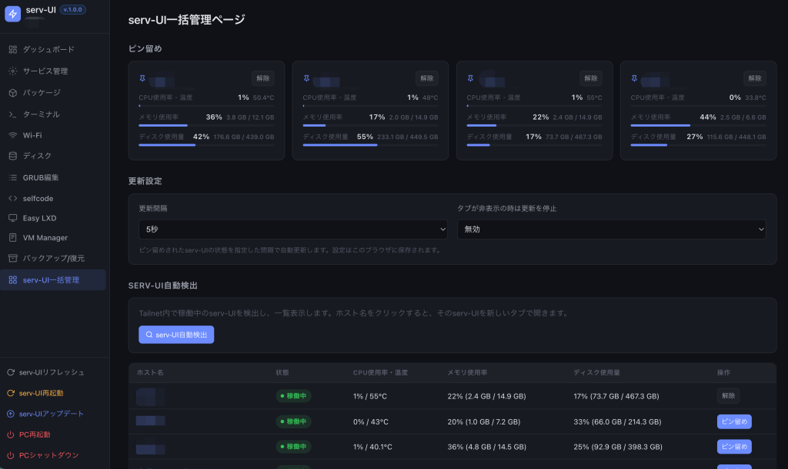

# serv-UI

Webベースのサーバー管理ツール (現在のバージョン: **v.3.3.0**)。Tailscale内のHTTPS経由でアクセス可能です。

## 機能

| 機能 | 説明 |
|------|------|
| ダッシュボード | CPU使用率・温度・メモリ・ディスク使用率・ネットワーク通信量・システム情報（ホスト名/OS/カーネル/稼働時間など）・トッププロセスを表示 |
| サービス管理 | systemdサービスの名前検索、起動・停止・再起動・有効/無効化・ステータス確認（サービス詳細出力も表示） |
| パッケージ管理 | aptアップデート確認・一括更新・個別更新・依存関係の修復・apt/dpkgロック解除・強制一括更新・不要パッケージ削除。更新を「アップデート ターミナル」で実行して進捗を確認することも可能 |
| 公開ポート | TCP/UDPでリッスン中のサービス（ポート番号・プロセス・アドレス）を検出して一覧表示 |
| ターミナル | ブラウザ上のWebターミナル（ユーザーアカウントで `~` に接続）。サーバー側でセッションを保持するため、ブラウザを閉じても実行中の処理は継続し、再接続時に出力を復元。「新規セッション」「接続」「クリア」「セッション終了」を操作可能 |
| Wi-Fi管理 | 周囲のWi-Fiスキャン・接続（パスワード入力）・切断・設定削除（forget）・Wi-Fi機能の有効/無効切替 |
| ディスク情報 | パーティション・マウント・ファイルシステム・使用率の情報表示専用ページ（操作は Disk Manager で実施） |
| Disk Manager | パーティションのマウント（一時/永続）・作成・拡張・削除、LVM (VG/LV) の作成・リサイズ・削除。連携アプリ（[hirogura/diskmanager](https://github.com/hirogura/diskmanager)）を未インストールなら確認後にターミナルでインストールし、インストール済みなら別タブで開く |
| GRUB編集 | GRUBエントリーの一覧・削除、ISOループブートエントリーの追加、GRUB設定バックアップのクリーンアップ、次回起動時のみGRUBメニューを表示。ISOは `/iso` 内のものを検索するほか、WebからUbuntu ISO（releases.ubuntu.com）や任意URLのISOをダウンロード（進捗表示・キャンセル対応）可能。EFIブートエントリーの参考表示もあり |
| 連携アプリ (selfEx / selfcode / Easy LXD / VM Manager) | 各アプリの導入状態を確認。未インストールの場合は確認ダイアログ表示後にターミナルでインストール、インストール済みならサイトを新しいタブで開く |
| バックアップ/復元 | `/iso` 内の Clonezilla Live ISO をループバックブートして無人実行するパーティション単位のバックアップ・復元。ISOのWebダウンロード（進捗・キャンセル対応）にも対応 |
| Timeshift | rsync/btrfs モードでのスナップショット作成・一覧・削除・復元、除外フォルダ設定、cronによるスケジュール設定（頻度・保持数・メール抑止）。インストールもWebから実施可能 |
| アプリ/設定 | 各アプリのインストール、Bing壁紙の自動取得・設定、デスクトップショートカットの作成、Ventoy-UI（Webアプリ）の導入・起動、ノートPCの蓋閉じスリープ抑止の設定 |
| serv-UI一括管理 | Tailnet内で稼働中のserv-UIを自動検出して一覧表示。ピン留めしたサーバー（ホスト名/CPU使用率・温度/メモリ使用率/ディスク使用量）をページ上部に固定表示し、ホスト名クリックで新しいタブで開く。更新間隔と「タブ非表示時に更新停止」をブラウザに保存可能 |
| システム操作 | serv-UIのリフレッシュ（ブラウザ再読み込み）・再起動・アップデート（セルフアップデート）、PC本体の再起動・シャットダウン |



### バックアップ/復元について

`/iso` に保存した Clonezilla Live ISO を GRUB ループバックブートで起動する無人バックアップ/復元機能です（cloneauto等のインストールは不要）。

- **パーティションのみ対応**（LVMは非対応）
- 事前に**保存用パーティション**を用意し、**`/iso` にマウント**しておく必要があります
- `clonezilla-live-*.iso` を `/iso` 直下に配置しておきます（Web画面からダウンロードすることも可能）
- 実行すると `/etc/grub.d/40_custom` に無人実行用エントリを生成し、`grub-reboot` で次回起動のみ Clonezilla Live を起動して処理を行います（完了後は自動で再起動し、通常起動に戻ります）
- 初回実行時に `GRUB_DEFAULT=saved` へ自動変更されます
- 復元では保存先パーティション内のバックアップイメージを選択できます
- **Secure Boot非対応**のため、無効化しておく必要があります

### Timeshiftについて

システムのスナップショット管理を行います（[Timeshift](https://github.com/linuxmint/timeshift) のWebフロントエンド）。

- **rsync モード**と **btrfs モード**の両方に対応
- スナップショットの作成・一覧・削除・復元、コメントや除外フォルダ（LXDプール / VMイメージ / キャッシュなどのテンプレート付き）の設定が可能
- スケジュールを設定すると cron により自動作成されます（既定は手動作成のみ。頻度・保持数・cronメール送信の有無を設定可能）
- 復元を実行したあとは、手動で再起動してください（自動再起動はしません）
- 初回は「セットアップ」から Timeshift 本体をインストールします

### アプリ/設定について

デスクトップ利用向けの便利機能をまとめたページです。

- **アプリのインストール**: Google Chrome / Microsoft Edge / Thunderbird / LibreOffice / VLC / SSH / BingWall から選択してターミナルでインストール（Chrome / Edge は公式 .deb を取得するため時間がかかる場合があります）
- **Bing壁紙**: cron + 軽量スクリプトで毎日 07:30 とPC起動時に、その日の Bing 画像（UHD対応）を1日1回取得して GNOME の壁紙に設定。有効/無効切替と「今すぐ取得」に対応
- **デスクトップショートカット**: Chrome / Edge / Thunderbird 等の `.desktop` ファイルをデスクトップにコピー
- **Ventoy-UI**: [hirogura/ventoy-ui](https://github.com/hirogura/ventoy-ui) を systemd サービスとして導入・起動し、ブラウザから Ventoy USB を作成
- **設定**: systemd-logind の蓋閉じ動作を `ignore` に設定し、デスクトップ環境なしで運用するノートPCが画面を閉じてもスリープしないようにできます

## インストール

### 前提条件

- Ubuntu Server (20.04+)
- Tailscale がインストール・接続済み

```bash
# Tailscale インストール (未インストールの場合)
curl -fsSL https://tailscale.com/install.sh | sh

# Tailscale 接続
tailscale up
```

`setup.sh` が Python 3 / venv / git / NetworkManager / iw / wpasupplicant などの依存パッケージも自動でインストールします。

### Ubuntu Server インストール直後なら下記で一気に（推奨）

```bash
# 1. スクリプトをダウンロード
wget https://raw.githubusercontent.com/hirogura/servui/main/ubsv.sh

# 2. 実行
bash ubsv.sh
```

`ubsv.sh` は以下を自動で実行します:

1. タイムゾーンを JST (`Asia/Tokyo`) に設定
2. `apt update` / `apt upgrade` でパッケージを最新化（keyboard-configuration等のdebconf質問は自動回答でスキップ）
3. Tailscale のインストール
4. Tailscale 接続（authkey があれば入力して自動接続、なければブラウザ認証。authkey失敗時は再試行/ブラウザ認証を選択可）
5. git インストールと、serv-UIリポジトリのクローン
6. `setup.sh` による serv-UI のインストール

### 自動インストール (通常)

```bash
git clone https://github.com/hirogura/servui.git
cd servui
sudo bash setup.sh
```

オプション:

```bash
sudo bash setup.sh --branch test    # 指定ブランチからインストール (デフォルト: main)
sudo bash setup.sh --no-restart     # デプロイのみ行い、再起動は手動で実施
```

スクリプトは以下を自動で実行します:

1. 依存パッケージ（Python 3 / venv / git / NetworkManager / iw / wpasupplicant）のインストール
2. `servui` ユーザーの作成
3. sudoers の設定 (systemctl / apt / dpkg / reboot / poweroff / nmcli / iw 等のコマンドをパスワードなしで実行可能。ターミナル利用のためUID 1000の主ユーザーにも設定)
4. GitHub からリポジトリを取得して `/opt/servui` にデプロイ（既存環境は `git reset --hard` で更新）
5. Python 仮想環境の作成と依存パッケージのインストール
6. systemd サービス (`servui.service`) の作成・起動
7. `tailscale serve` の設定 (HTTPS:3355)

### アクセス

Tailscale ネットワーク内のブラウザから:

```
https://YOUR-TAILSCALE-HOSTNAME:3355
```

※LANからはアクセス不可。Tailscale内からのみアクセス可能。

## アンインストール

```bash
git clone https://github.com/hirogura/servui.git
cd servui
sudo bash uninstall.sh
```

以下のものが削除されます:

- systemd サービス (servui.service)
- sudoers 設定 (/etc/sudoers.d/servui-systemctl と主ユーザーの -nopasswd 設定)
- アプリケーション (/opt/servui)
- servui ユーザー
- Tailscale serve 設定 (HTTPS:3355)

## サービス管理

```bash
# ステータス
systemctl status servui

# 再起動
sudo systemctl restart servui

# ログ
journalctl -u servui -f

# 停止
sudo systemctl stop servui
```

## セキュリティ

- ポート3355は**Tailscale内のみ**で公開
- LANからはアクセス不可 (`tailscale serve` が外部リクエストを拒否)
- `servui` ユーザーによる権限分離と sudoers によるコマンド制御
- ターミナルは `setpriv` で主ユーザーに切り替えて実行（Webサービス自体は Tailscale serve 経由でのみ公開）
- なお、セットアップ時に対象サーバーの管理を容易にするため、UID 1000 の主ユーザーにはパスワードなし sudo が設定されます（不要な場合は `/etc/sudoers.d/<ユーザー>-nopasswd` を削除してください）

## アーキテクチャ

```
[ブラウザ (Tailscale内)]
    │
    ▼ HTTPS:3355
[Tailscale Serve] ← TLS終端
    │
    ▼ HTTP:127.0.0.1:3355
[FastAPI (serv-UI)]
    │
    ├── psutil (システム情報)
    ├── systemctl (サービス管理)
    ├── apt / dpkg (パッケージ管理・ロック解除)
    ├── ss / lsof (リッスンポート検出)
    ├── NetworkManager / iw / wpa_cli (Wi-Fi管理)
    ├── lsblk / mount / LVM (ディスク情報。操作は Disk Manager 連携)
    ├── grub関連ファイル / wget (GRUB編集・ISOダウンロード)
    ├── Clonezilla Live ISO ループバックブート (バックアップ/復元)
    ├── Timeshift (スナップショット / cronスケジュール)
    ├── apt / gio / cron / systemd-logind (アプリ・壁紙・蓋閉じ設定)
    ├── Tailscale API (serv-UI一括管理 / 連携アプリURL取得)
    └── WebSocket + PTY (永続ターミナルセッション)
```

## 開発

```bash
git clone https://github.com/hirogura/servui.git
cd servui
python3 -m venv venv
source venv/bin/activate
pip install -r requirements.txt
uvicorn main:app --host 127.0.0.1 --port 3355 --reload
```

ブラウザで `http://127.0.0.1:3355` を開きます（開発時は root または sudoers 設定済みユーザーで起動してください）。

## License

[MIT](LICENSE)
